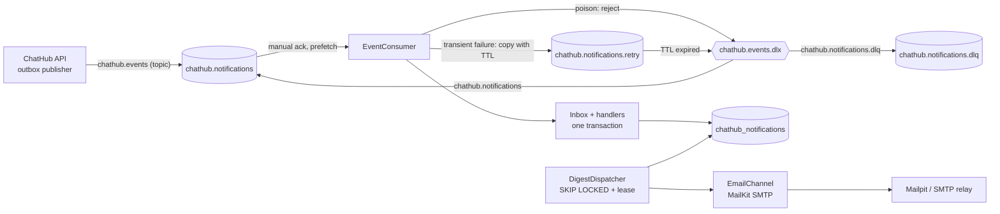

# ChatHub notification service

`ChatHub.Notifications` is a separate worker that consumes ChatHub's integration events from RabbitMQ (see [MESSAGING.md](MESSAGING.md)) and sends **email digests** to people who did not read their messages, like WhatsApp's "you have unread messages" email. Email is the only channel today; the code is built so Web Push can be added as a second channel.

It references only `ChatHub.Contracts`. It never reads the ChatHub database: everything it knows comes from events, and it keeps its own state in its own database, `chathub_notifications`.

## Why one project instead of four layers

The API uses Clean Architecture (Domain / Application / Infrastructure / WebAPI) because it has a rich domain: aggregates with invariants, many use cases, and several adapters that need to be swapped in tests. The worker has none of that: five event handlers whose rules are a few SQL statements, one scheduler and one outbound channel. Splitting it into four projects would mostly add mapping and indirection.

The boundaries that matter are kept as folders and interfaces inside one project:

- `Persistence`: the EF Core model, migrations and retention cleanup.
- `Messaging`: the RabbitMQ topology, the consumer, the envelope reader and the inbox processor.
- `Digests`: the rules (handlers, dispatcher, settings).
- `Channels`: `INotificationChannel` and `Channels/Email`.
- `Health`: health checks.

`IIntegrationEventProcessor` and `INotificationChannel` are the seams the tests replace. If the service grows (more channels, user preferences, an API to manage them), splitting it is mechanical.

## Flow



1. The API commits a business change and its outbox row together, then publishes the event (phase 1).
2. `EventConsumer` receives it from `chathub.notifications`, validates it, and hands it to `IntegrationEventProcessor`.
3. The processor inserts the event's `MessageId` into `ProcessedMessages` and applies the handler **in the same transaction**. A redelivered message hits the primary key and changes nothing.
4. `MessageSent` creates or extends a pending digest per recipient. `ConversationRead` shrinks or cancels it. User events maintain the recipient read model.
5. `DigestDispatcher` claims digests that are due, re-checks them, sends them through the channels, and records the result.

## Digest rules

| Rule | Behaviour |
|---|---|
| Delay | Nothing is sent right away. A digest per (recipient, conversation) becomes due `DigestDelaySeconds` (default 120) after the **first** unread message. Later messages are folded in (count, last sender, last preview) without moving the due time. |
| Read | A `ConversationRead` up to or past every message in the digest cancels it. A partial read removes only the messages it covers; the count drops and the clock restarts at the first message still unread. |
| Read before message | Reads are remembered per (user, conversation) as the maximum `ReadUpToUtc`. A `MessageSent` with `SentAtUtc <= ReadUpToUtc` creates nothing, even when the read event was consumed first. |
| Cooldown | After a digest is sent, the next one for the same (recipient, conversation) is due no earlier than `CooldownMinutes` (default 15) later. Messages during the cooldown accumulate and go out when it ends, if they are still unread. Other conversations are not affected. |
| Skipped | The sender; recipients the API marked as muted (`MutedRecipientUserIds`); deleted users; users no channel can reach (today: no email address, i.e. phone-only accounts). Messages older than `MaxMessageAgeHours` (default 24) are ignored, so a long outage does not send emails about yesterday. |
| Send-time checks | Just before sending, the dispatcher re-reads the recipient (current email, deleted?) and the read pointer, and counts the unread messages again. Unknown recipients (no user event received yet) are dropped at that point. |
| Content | Direct chat: "**&lt;Sender&gt; sent you N new message(s)**". Group: "**N new message(s) in &lt;Title&gt;**". Body: greeting, summary, the latest preview (unless `IncludePreview` is false) and a link `AppBaseUrl/conversations/{id}`. Plain text and simple HTML; user content is HTML-encoded. All wording is in `Channels/Email/DigestEmailTemplate.cs`. |

## Data model (`chathub_notifications`)

| Table | Key | Purpose |
|---|---|---|
| `Recipients` | `UserId` | Read model: `Email` (nullable), `DisplayName`, `IsDeleted`, `LastEventAtUtc`. Updated only by a user event newer than `LastEventAtUtc`; deletion is terminal and clears the email. |
| `ProcessedMessages` | `MessageId` | Inbox. Written first in every handler transaction. |
| `ConversationReads` | `UserId, ConversationId` | Highest `ReadUpToUtc` seen (`GREATEST` on upsert, so an old read arriving late never moves it back). |
| `PendingDigests` | `UserId, ConversationId` | One per recipient and conversation with unread messages: type, title, `FirstUnreadAtUtc`, `LastMessageAtUtc`, `MessageCount`, `LastSenderName`, `LastPreview`, `DueAtUtc`, plus delivery state `LockedUntilUtc`, `Attempts`, `LastError`, `FailedAtUtc`. Partial index on `DueAtUtc WHERE FailedAtUtc IS NULL`. |
| `DigestMessages` | `UserId, ConversationId, ChatMessageId` | One row per unread chat message per recipient (`SentAtUtc` only). |
| `DigestCooldowns` | `UserId, ConversationId` | `LastSentAtUtc` of the last digest. |
| `SentNotifications` | `Id` | Log of what was sent: user, conversation, channel, message count, time. |

Two additions to the suggested schema:

- **`DigestMessages`.** With only aggregate columns, a partial read cannot say how many messages are left or which unread one is now first. One small row per (recipient, message) makes a partial read exact (`DELETE … WHERE SentAtUtc <= ReadUpToUtc`). Its primary key also makes folding idempotent per chat message, so even a re-published event with a new `MessageId` is not counted twice. Rows are deleted when the digest is read or sent.
- **`DigestCooldowns` as its own table.** The pending digest is deleted once nothing is unread, but the cooldown must outlive it.

Retention: an hourly cleanup deletes `ProcessedMessages`, `SentNotifications` and `ConversationReads` older than `InboxRetentionDays` (default 7, must exceed `MaxMessageAgeHours`), and cooldowns that have expired. Migration: `20261122140523_InitialNotifications`.

## RabbitMQ topology

The service declares everything it uses at startup (all durable, classic queues), so it can start before or after the API:

| Name | Kind | Details |
|---|---|---|
| `chathub.events` | topic exchange | Declared by the API too, with the same arguments. |
| `chathub.notifications` | queue | Bound to `chathub.events` with `message.sent`, `conversation.read`, `user.registered`, `user.profile-updated`, `user.deleted` (`MessageRoutes`). Dead-letters to `chathub.events.dlx` with routing key `chathub.notifications.dlq`. |
| `chathub.events.dlx` | direct exchange | Routes `chathub.notifications.dlq` to the DLQ and `chathub.notifications` back to the main queue. |
| `chathub.notifications.retry` | queue, no consumers | Holds retries until their per-message TTL expires, then dead-letters them to `chathub.events.dlx` with routing key `chathub.notifications`, i.e. back to the main queue. |
| `chathub.notifications.dlq` | queue | Messages that will not be processed. |

Consumer behaviour:

- **Manual acks, prefetch** `PrefetchCount` (default 16), one message at a time. `AutomaticRecoveryEnabled` and topology recovery handle broker restarts. A watchdog reconnects from scratch if the connection has not recovered after 30 s, and an initial connection failure is retried with backoff (1, 2, 4 … 30 s).
- **Poison → DLQ immediately** (`basic.reject`, no requeue): unknown routing key, missing or invalid `message_id`, malformed JSON, `message_id` different from the payload's `messageId`, missing required fields. They are logged at Warning.
- **Transient failure → retry queue.** Any exception while processing (database down, timeout, a bug) republishes a copy to `chathub.notifications.retry` with a per-message TTL of `RetryDelayMilliseconds × 2^(attempt-1)` (5, 10, 20, 40 s by default). The copy carries the headers `chathub-delivery-attempts` and `chathub-routing-key`, because the original routing key is lost on the way back. Then the original is acked. The consumer never sleeps, so other messages keep flowing. If the copy cannot be published, the original is nacked with requeue.
- **After `MaxDeliveryAttempts`** (default 5) the message is rejected to the DLQ and logged at Error. The `x-death` header shows its history.
- Per-message TTLs expire only at the head of the retry queue, so a short-TTL retry can wait behind a longer one. That delays a retry, it never loses one. If that matters, use one retry queue per delay.

To replay the DLQ after fixing the cause: in the management UI open `chathub.notifications.dlq`, **Move messages** to `chathub.notifications`. Duplicates are harmless.

## Idempotency and ordering

Delivery is at-least-once (the API outbox can republish, RabbitMQ can redeliver), and events can arrive in any order (two API replicas, retries, the retry queue). Each case is handled:

- **Duplicates:** the inbox insert is the first statement of the transaction; a second delivery finds the `MessageId` and commits nothing. Two replicas processing the same message concurrently serialize on the primary key.
- **Read before message:** `ConversationReads` keeps the maximum, and `MessageSent` checks it.
- **Older message after newer:** `FirstUnreadAtUtc = LEAST`, `LastMessageAtUtc = GREATEST`, and last sender, preview and title come from the newest message by `SentAtUtc`, not by arrival.
- **User events:** applied only if newer than `LastEventAtUtc`. `UserDeleted` always wins and deletes the user's digests, cooldowns and read markers.
- **New message while a digest is being sent:** the dispatcher removes only messages up to the `LastMessageAtUtc` it sent. Newer ones stay and are scheduled after the cooldown.

## Dispatcher

Same pattern as the API's outbox publisher, so two worker replicas are safe:

```sql
UPDATE "PendingDigests" p SET "LockedUntilUtc" = @now + lease
FROM (SELECT "UserId", "ConversationId" FROM "PendingDigests"
      WHERE "FailedAtUtc" IS NULL AND "DueAtUtc" <= @now AND ("LockedUntilUtc" IS NULL OR "LockedUntilUtc" <= @now)
      ORDER BY "DueAtUtc" LIMIT @batch FOR UPDATE SKIP LOCKED) due
WHERE p."UserId" = due."UserId" AND p."ConversationId" = due."ConversationId"
RETURNING p.*;
```

- For the claimed batch it loads recipients and unread counts in two queries, then sends each digest through every channel that can reach the recipient.
- **Success:** one transaction sets the cooldown, removes the sent messages, deletes the digest or reschedules newer messages, and writes `SentNotifications`.
- **Failure:** `Attempts + 1`, `LastError`, and `LockedUntilUtc = now + RetryBaseDelaySeconds × 2^(attempts-1)` (capped at 1 h). After `MaxAttempts` the row gets `FailedAtUtc`, is logged at Error, and is no longer claimed. A new message in that conversation resets it and tries again.
- **Lease** (`LeaseSeconds`, default 120, validated to be at least twice the SMTP timeout): a batch stops and releases its remaining digests after half the lease, so a slow relay cannot let another replica claim a digest that is still being sent.
- **At-least-once:** if the process dies after the SMTP server accepted an email but before the success transaction commits, the lease expires and the digest is sent again. A duplicate email is preferred over a lost one.

## Channels

```csharp
public interface INotificationChannel
{
    string Name { get; }
    bool CanDeliverTo(Recipient recipient);
    Task SendAsync(DigestNotification notification, CancellationToken cancellationToken);
}
```

`EmailChannel` (MailKit) is the only implementation. To add Web Push:

1. Store subscriptions (a `PushSubscriptions` table fed by a new event or an endpoint on this service).
2. Implement `PushChannel` (`CanDeliverTo` = has a subscription; `SendAsync` renders its own short title and body from the same `DigestNotification`).
3. Register it as another `INotificationChannel`. Digests then go out on every channel that can reach the recipient, and `SentNotifications.Channel` records each.

Today a failure on any channel retries the whole digest, which could repeat a channel that succeeded. With two channels, move delivery state per channel: a `(UserId, ConversationId, Channel)` key, or a small deliveries table.

## Configuration

Validated at startup; the service refuses to start with invalid values.

| Setting | Default | Meaning |
|---|---|---|
| `ConnectionStrings:Notifications` | (required) | The service's own database |
| `Notifications:DigestDelaySeconds` | `120` (15 in Development) | Wait after the first unread message |
| `Notifications:CooldownMinutes` | `15` | Minimum gap between digests for the same conversation |
| `Notifications:IncludePreview` | `true` | Put the latest message text in the email |
| `Notifications:AppBaseUrl` | `http://localhost:3000` | Base of the link in the email (placeholder for the future web client) |
| `Notifications:MaxAttempts` / `RetryBaseDelaySeconds` | `5` / `30` | Send retries and their backoff |
| `Notifications:PollIntervalMilliseconds` / `BatchSize` / `LeaseSeconds` | `1000` / `20` / `120` | Dispatcher loop |
| `Notifications:InboxRetentionDays` / `MaxMessageAgeHours` | `7` / `24` | Retention, and how old a message may be to still be emailed |
| `RabbitMq:Host` / `Port` / `User` / `Password` / `VirtualHost` | `localhost` / `5672` / (required) / (required) / `/` | Broker |
| `RabbitMq:PrefetchCount` / `MaxDeliveryAttempts` / `RetryDelayMilliseconds` | `16` / `5` / `5000` | Consumer |
| `Smtp:Host` / `Port` | `localhost` / `1025` | SMTP server |
| `Smtp:Security` | `None` | `None`, `StartTls`, `SslOnConnect` or `Auto` (MailKit `SecureSocketOptions`) |
| `Smtp:User` / `Password` | empty | No authentication when `User` is empty |
| `Smtp:FromAddress` / `FromName` / `TimeoutSeconds` | `notifications@chathub.local` / `ChatHub` / `30` | Sender and per-operation timeout |

docker-compose maps them from `.env`:

- `SMTP_HOST`, `SMTP_PORT`, `SMTP_SECURITY`, `SMTP_USER`, `SMTP_PASSWORD`, `SMTP_FROM_ADDRESS`, `SMTP_FROM_NAME`
- `NOTIFICATIONS_DIGEST_DELAY_SECONDS`, `NOTIFICATIONS_COOLDOWN_MINUTES`, `NOTIFICATIONS_INCLUDE_PREVIEW`, `NOTIFICATIONS_APP_BASE_URL`, `NOTIFICATIONS_DB`, `NOTIFICATIONS_DB_MAX_POOL_SIZE`
- `RABBITMQ_USER`, `RABBITMQ_PASSWORD`, shared with the API

## Running it

docker-compose starts four services for this:

- `notifications-migrator`: an EF migrations bundle. It **creates `chathub_notifications`** on the first run (the compose PostgreSQL user owns the server) and applies the migrations. On that first run it logs one "error occurred using the connection" line: EF probing the database before creating it.
- `notifications`: one replica. Health check: `/health/ready` through a bash TCP probe; `/health/live` is also exposed. Depends on PostgreSQL being healthy, RabbitMQ being started, and the migrator having finished.
- `mailpit`: catches all email. UI and API on http://127.0.0.1:8025; its SMTP port is only on the compose network.

```bash
docker compose up -d
# demo timings: email 15 s after the first unread message, 1 minute cooldown
NOTIFICATIONS_DIGEST_DELAY_SECONDS=15 NOTIFICATIONS_COOLDOWN_MINUTES=1 docker compose up -d
```

With `MESSAGING_ENABLED=false` the API publishes nothing, so the service stays idle and healthy.

### Backfill existing users

Users created before the service existed, and all seeded users (the seeder writes rows directly, without events), are unknown to the read model, and digests to unknown users are dropped. Queue one `UserProfileUpdated` per user that is not deleted, through the normal outbox:

```bash
docker compose --profile seed run --rm seeder --confirm --backfill-notifications
# outside Docker
dotnet run --project tools/ChatHub.Seeder -- --confirm --backfill-notifications --connection "<ChatHub connection string>" --batch-size 1000
```

It pages through users by id in batches (`--batch-size`, default 1000). It builds the events with the API's own `IntegrationEventMapper` and `OutboxMessage.From`, and inserts only outbox rows; the publisher delivers them like any other event. Each batch is stamped with the time *before* it was read, so a real profile change that happens meanwhile still wins. Running it twice is harmless. On the dev database: 1,011 users in 2 batches in 4.6 s, all present in `Recipients` a few seconds later.

### Viewing emails in Mailpit

Open http://127.0.0.1:8025. Every digest appears with its plain-text and HTML parts, its headers (`X-ChatHub-Conversation` carries the conversation id), and a link check. Mailpit keeps the most recent 500 messages. Its API (`/api/v1/messages`, `/api/v1/message/{id}`) is what the SMTP test uses.

### Switching to a real SMTP provider

Only configuration changes. For Brevo's free tier, for example, create an SMTP key and verify a sender, then in `.env`:

```bash
SMTP_HOST=smtp-relay.brevo.com
SMTP_PORT=587
SMTP_SECURITY=StartTls
SMTP_USER=<your Brevo SMTP login>
SMTP_PASSWORD=<your SMTP key>
SMTP_FROM_ADDRESS=<the verified sender>
SMTP_FROM_NAME=ChatHub
```

and `docker compose up -d notifications`. Use `SslOnConnect` with port 465 for relays that require implicit TLS. Free tiers cap daily volume (Brevo: 300 emails a day). A sender address on a domain with SPF/DKIM set up is what keeps digests out of spam folders.

## Health and operations

- `/health/live`: always 200 if the process runs.
- `/health/ready`: `database` (EF `CanConnect`) and `rabbitmq` (the consumer's connection and channel are open), both Unhealthy on failure. Without either, the worker cannot do its job.

```sql
-- digests waiting, due soonest first
SELECT "UserId", "ConversationId", "MessageCount", "DueAtUtc", "Attempts", "LastError", "FailedAtUtc"
FROM "PendingDigests" ORDER BY "DueAtUtc" LIMIT 50;
-- digests that gave up
SELECT * FROM "PendingDigests" WHERE "FailedAtUtc" IS NOT NULL;
-- what was sent recently
SELECT "Channel", count(*), sum("MessageCount") FROM "SentNotifications" WHERE "SentAtUtc" > now() - interval '1 hour' GROUP BY 1;
```

## Tests

`tests/ChatHub.Notifications.Tests` runs against PostgreSQL and RabbitMQ containers (plus a Mailpit container for one class), with `FakeTimeProvider` and a fake channel:

- `DigestRulesTests`: delay, folding, read, partial read, read before message, duplicates, skipped recipients, group fan-out with a constant number of SQL statements, cooldown, deleted users, send-time checks, out-of-order messages.
- `DispatcherTests`: backoff and giving up, recovery, two dispatchers without double sends, lease expiry, a message arriving while sending.
- `RecipientTests`: out-of-order and post-deletion user events.
- `ConsumerTests`: the real consumer against RabbitMQ: ack, duplicate delivery, four kinds of poison message to the DLQ, retry queue then success, DLQ after max attempts.
- `EmailChannelTests`: real SMTP into Mailpit asserted through its HTTP API, plus template tests.
- `HostTests`: `/health/ready` on the real host, startup validation, retention cleanup.

The backfill is tested in `Application.IntegrationTests/Features/SeederTests`.
