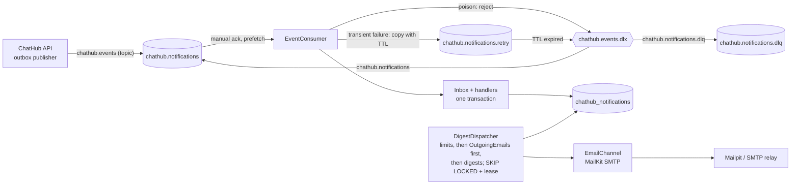

# ChatHub notification service

`ChatHub.Notifications` is a separate worker that consumes ChatHub's integration events from RabbitMQ (see [MESSAGING.md](MESSAGING.md)) and sends **email digests** to people who did not read their messages, like WhatsApp's "you have unread messages" email. It also sends the **transactional** email that confirms a new address. Email is the only channel today; the code is built so Web Push can be added as a second channel.

It references only `ChatHub.Contracts`. It never reads the ChatHub database: everything it knows comes from events, and it keeps its own state in its own database, `chathub_notifications`.

## Why one project instead of four layers

The API uses Clean Architecture (Domain / Application / Infrastructure / WebAPI) because it has a rich domain: aggregates with invariants, many use cases, and several adapters that need to be swapped in tests. The worker has none of that: a dozen event handlers whose rules are a few SQL statements, one scheduler and one outbound channel. Splitting it into four projects would mostly add mapping and indirection.

The boundaries that matter are kept as folders and interfaces inside one project:

- `Persistence`: the EF Core model, migrations and retention cleanup.
- `Messaging`: the RabbitMQ topology, the consumer, the envelope reader and the inbox processor.
- `Digests`: the rules (handlers, dispatcher, settings).
- `Transactional`: emails that are not digests, one per event (today: address verification), queued in `OutgoingEmails`.
- `Sending`: the sending limits (`SendQuota`) and the suppressed domains (`EmailSuppression`).
- `Channels`: `INotificationChannel`, the `Notification` base record and `Channels/Email`.
- `Health`: health checks.

`IIntegrationEventProcessor` and `INotificationChannel` are the seams the tests replace. If the service grows (more channels, user preferences, an API to manage them), splitting it is mechanical.

## Flow



1. The API commits a business change and its outbox row together, then publishes the event (phase 1).
2. `EventConsumer` receives it from `chathub.notifications`, validates it, and hands it to `IntegrationEventProcessor`.
3. The processor inserts the event's `MessageId` into `ProcessedMessages` and applies the handler **in the same transaction**. A redelivered message hits the primary key and changes nothing.
4. `MessageSent` creates or extends a pending digest per recipient. `ConversationRead`, `MessageDeleted`, `MemberLeft`, `MemberKicked` and a mute shrink or cancel it; `MessageEdited` updates its preview; `UserStatusChanged` postpones it while the recipient is online. User events maintain the recipient read model (address, verified flag, email preference, unsubscribe link).
5. `EmailVerificationRequested` is queued in `OutgoingEmails` in the same transaction (see [Email verification](#email-verification)).
6. `DigestDispatcher` checks the [sending limits](#sending-limits), sends the queued transactional emails first, then claims the digests that are due, re-checks them, sends them through the channels, and records the result.

## Digest rules

| Rule | Behaviour |
|---|---|
| Delay | Nothing is sent right away. A digest per (recipient, conversation) becomes due `DigestDelaySeconds` (default 120) after the **first** unread message. Later messages are folded in (count, last sender, last preview) without moving the due time. |
| Read | A `ConversationRead` up to or past every message in the digest cancels it. A partial read removes only the messages it covers; the count drops and the clock restarts at the first message still unread. |
| Read before message | Reads are remembered per (user, conversation) as the maximum `ReadUpToUtc`. A `MessageSent` with `SentAtUtc <= ReadUpToUtc` creates nothing, even when the read event was consumed first. |
| Cooldown | After a digest is sent, the next one for the same (recipient, conversation) is due no earlier than `CooldownMinutes` (default 15) later. Messages during the cooldown accumulate and go out when it ends, if they are still unread. Other conversations are not affected. |
| Skipped | The sender; recipients the API marked as muted (`MutedRecipientUserIds`); deleted users; users who turned email notifications off; addresses in a [suppressed domain](#suppressed-domains); users no channel can reach and who are not waiting for verification (today: no email address, i.e. phone-only accounts). Messages older than `MaxMessageAgeHours` (default 24) are ignored, so a long outage does not send emails about yesterday. |
| Verified address only | `EmailChannel` delivers a digest only to a verified address (`Recipient.CanReceiveEmailDigests`: not deleted, has an email, `EmailVerified`, `EmailNotificationsEnabled`). A recipient whose address is **not verified yet** still collects digests; when one is due the dispatcher holds it (`LockedUntilUtc = now + HoldRecheckSeconds`, default 60) instead of dropping it, and sends it at the first check after the `UserProfileUpdated` with `emailVerified: true` arrives. A new, unverified address after an email change is held the same way. |
| Deleted messages | `MessageDeleted` ("delete for everyone", the only delete there is) removes that message from every digest and recomputes count, first unread (the clock restarts there), last sender and preview from the newest message still in it, or cancels the digest. The preview comes from `MessageSnapshots`, so an email never shows a deleted message. A tombstone makes a `MessageSent` that arrives after its deletion create nothing. |
| Edited messages | `MessageEdited` keeps the newest text per message (by `EditedAtUtc`, so edits can arrive in any order, even before the `MessageSent`) and updates the preview of every digest whose newest message it is. An edit after a delete changes nothing. |
| Left, kicked, muted | `MemberLeft`, `MemberKicked` and `ConversationMuteChanged(isMuted: true)` move the user's read marker to the event's time: the pending digest is dropped, and a `MessageSent` from before that moment arriving late is ignored, exactly like a read. Messages after a rejoin are newer, so they count again; no "member added" event is needed. Unmute does nothing: `MessageSent` already lists who is muted when each message is sent. |
| Recipient online | Emails are for people who are away. While `UserStatusChanged` says the recipient is online, a due digest is held (checked again every `HoldRecheckSeconds`), never dropped. When they go offline, every pending digest of theirs becomes due no earlier than `wentOfflineAt + DigestDelaySeconds` (`DueAtUtc = max(DueAtUtc, offline + delay)`), and is sent at the next check after that. Presence is newest-wins by `occurredAtUtc`; a flapping connection only moves the due time later, so it cannot cause a burst. |
| Sending limits | Every email passes the [limits](#sending-limits). A digest over its recipient's hourly cap waits; the global limits make digests wait without failing or counting an attempt. |
| Send-time checks | Just before sending, the dispatcher re-reads the recipient (current email, deleted, verified, preference) and the read pointer, and counts the unread messages again, ignoring messages older than `MaxMessageAgeHours`. A digest left with nothing to count, including one held so long that its messages aged out, is removed. Unknown recipients (no user event received yet) are dropped at that point. |
| Content | Direct chat: "**&lt;Sender&gt; sent you N new message(s)**". Group: "**N new message(s) in &lt;Title&gt;**". Body: greeting, summary, the latest preview (unless `IncludePreview` is false), a link `AppBaseUrl/conversations/{id}`, and an unsubscribe link (plus `List-Unsubscribe` headers, see [Unsubscribe](#unsubscribe)). Plain text and simple HTML; user content is HTML-encoded. All wording is in `Channels/Email/DigestEmailTemplate.cs`. |

## Data model (`chathub_notifications`)

| Table | Key | Purpose |
|---|---|---|
| `Recipients` | `UserId` | Read model: `Email` (nullable), `DisplayName`, `IsDeleted`, `EmailVerified`, `EmailNotificationsEnabled`, `LastEventAtUtc`, and `UnsubscribeLink` with its own `UnsubscribeLinkIssuedAtUtc`. Profile fields are updated only by a user event newer than `LastEventAtUtc`; the link only by a newer link. Deletion is terminal and clears the email, the flags and the link. |
| `ProcessedMessages` | `MessageId` | Inbox. Written first in every handler transaction. |
| `ConversationReads` | `UserId, ConversationId` | Highest `ReadUpToUtc` seen (`GREATEST` on upsert, so an old read arriving late never moves it back). Leaving, being kicked and muting move it too (to the event's time). |
| `PendingDigests` | `UserId, ConversationId` | One per recipient and conversation with unread messages: type, title, `FirstUnreadAtUtc`, `LastMessageAtUtc`, `MessageCount`, `LastSenderName`, `LastPreview`, `DueAtUtc`, plus delivery state `LockedUntilUtc`, `Attempts`, `LastError`, `FailedAtUtc`. Partial index on `DueAtUtc WHERE FailedAtUtc IS NULL`. |
| `DigestMessages` | `UserId, ConversationId, ChatMessageId` | One row per unread chat message per recipient (`SentAtUtc` only). |
| `DigestCooldowns` | `UserId, ConversationId` | `LastSentAtUtc` of the last digest. |
| `SentNotifications` | `Id` | Log of what was sent: user, conversation (null for transactional emails), channel, `Kind` (`Transactional` or `Digest`), message count, time. The sending limits count this table, so they survive restarts. |
| `MessageSnapshots` | `ChatMessageId` | One row per chat message that reached a digest, edit or delete: `SentAtUtc`, `SenderName`, `Preview` (newest edit wins), `EditedAtUtc`, `DeletedAtUtc` (tombstone), `RecordedAtUtc`. Shared by every recipient, so an edit or delete is one row, not one per recipient. |
| `RecipientPresence` | `UserId` | `IsOnline` and `ChangedAtUtc` of the newest `UserStatusChanged`. Separate from `Recipients` so presence can arrive before the user's first profile event. |
| `OutgoingEmails` | `Id` | Transactional emails waiting to be sent: template (`EmailVerification`), address, name, link, expiry, `CreatedAtUtc`, and delivery state `LockedUntilUtc`, `Attempts`, `LastError`, `FailedAtUtc`. Deleted when sent. |

Two additions to the suggested schema:

- **`DigestMessages`.** With only aggregate columns, a partial read cannot say how many messages are left or which unread one is now first. One small row per (recipient, message) makes a partial read exact (`DELETE … WHERE SentAtUtc <= ReadUpToUtc`). Its primary key also makes folding idempotent per chat message, so even a re-published event with a new `MessageId` is not counted twice. Rows are deleted when the digest is read or sent.
- **`DigestCooldowns` as its own table.** The pending digest is deleted once nothing is unread, but the cooldown must outlive it.

Retention: an hourly cleanup deletes `ProcessedMessages`, `SentNotifications`, `ConversationReads` and `MessageSnapshots` older than `InboxRetentionDays` (default 7, must exceed `MaxMessageAgeHours`, so a tombstone outlives any `MessageSent` that could still arrive), failed `OutgoingEmails` older than that, and cooldowns that have expired. Migrations: `20261122140523_InitialNotifications`, `20261122232935_AddEmailVerificationAndKinds` (existing recipients start unverified with email notifications on; existing log rows become `Digest`), `20261123133008_AddSnapshotsPresenceAndOutgoingEmails` (three new tables).

## RabbitMQ topology

The service declares everything it uses at startup (all durable, classic queues), so it can start before or after the API:

| Name | Kind | Details |
|---|---|---|
| `chathub.events` | topic exchange | Declared by the API too, with the same arguments. |
| `chathub.notifications` | queue | Bound to `chathub.events` with the twelve routing keys in [Events we publish](#events-we-publish-and-why) (`NotificationTopology.RoutingKeys`). Dead-letters to `chathub.events.dlx` with routing key `chathub.notifications.dlq`. |
| `chathub.events.dlx` | direct exchange | Routes `chathub.notifications.dlq` to the DLQ and `chathub.notifications` back to the main queue. |
| `chathub.notifications.retry` | queue, no consumers | Holds retries until their per-message TTL expires, then dead-letters them to `chathub.events.dlx` with routing key `chathub.notifications`, i.e. back to the main queue. |
| `chathub.notifications.dlq` | queue | Messages that will not be processed. |

Consumer behaviour:

- **Manual acks, prefetch** `PrefetchCount` (default 16), one message at a time. `AutomaticRecoveryEnabled` and topology recovery handle broker restarts. A watchdog reconnects from scratch if the connection has not recovered after 30 s, and an initial connection failure is retried with backoff (1, 2, 4 … 30 s).
- **Poison → DLQ immediately** (`basic.reject`, no requeue): unknown routing key, missing or invalid `message_id`, malformed JSON, `message_id` different from the payload's `messageId`, missing required fields. They are logged at Warning.
- **Transient failure → retry queue.** Any exception while processing (database down, timeout, a bug) republishes a copy to `chathub.notifications.retry` with a per-message TTL of `RetryDelayMilliseconds × 2^(attempt-1)` (5, 10, 20, 40 s by default). The copy carries the headers `chathub-delivery-attempts` and `chathub-routing-key`, because the original routing key is lost on the way back. Then the original is acked. The consumer never sleeps, so other messages keep flowing. If the copy cannot be published, the original is nacked with requeue.
- **After `MaxDeliveryAttempts`** (default 5) the message is rejected to the DLQ and logged at Error. The `x-death` header shows its history.
- Per-message TTLs expire only at the head of the retry queue, so a short-TTL retry can wait behind a longer one. That delays a retry, it never loses one. If that matters, use one retry queue per delay.

To replay the DLQ after fixing the cause: in the management UI open `chathub.notifications.dlq`, **Move messages** to `chathub.notifications`. Duplicates are harmless.

## Idempotency and ordering

Delivery is at-least-once (the API outbox can republish, RabbitMQ can redeliver), and events can arrive in any order (two API replicas, retries, the retry queue). Each case is handled:

- **Duplicates:** the inbox insert is the first statement of the transaction; a second delivery finds the `MessageId` and commits nothing. Two replicas processing the same message concurrently serialize on the primary key.
- **Read before message:** `ConversationReads` keeps the maximum, and `MessageSent` checks it.
- **Older message after newer:** `FirstUnreadAtUtc = LEAST`, `LastMessageAtUtc = GREATEST`, and last sender, preview and title come from the newest message by `SentAtUtc`, not by arrival.
- **User events:** applied only if newer than `LastEventAtUtc`, including `EmailVerified` and `EmailNotificationsEnabled`, so an old "unverified" event arriving late never undoes a verification. `UserDeleted` always wins and deletes the user's digests, cooldowns and read markers.
- **Unsubscribe links:** an event without a link keeps the stored one; a link replaces it only if it was issued later (`UnsubscribeLinkIssuedAtUtc`). The registration's link therefore survives even when a later profile update was consumed first.
- **Verification emails:** the inbox makes a redelivery a no-op once the row is queued. Sending happens later, in the dispatcher.
- **Delete before send, edit before send:** the snapshot row is written by whichever event arrives first; `MessageSent` never overwrites a tombstone or a newer edit.
- **Leave, kick or mute before the message:** the read marker already covers the message's `SentAtUtc`, so it is ignored, as with a read.
- **Presence:** applied only if newer than the stored `ChangedAtUtc`; an old "offline" arriving late changes nothing.
- **New message while a digest is being sent:** the dispatcher removes only messages up to the `LastMessageAtUtc` it sent. Newer ones stay and are scheduled after the cooldown.

## Dispatcher

Same pattern as the API's outbox publisher, so two worker replicas are safe:

```sql
UPDATE "PendingDigests" p SET "LockedUntilUtc" = @now + lease
FROM (SELECT "UserId", "ConversationId" FROM "PendingDigests"
      WHERE "FailedAtUtc" IS NULL AND "DueAtUtc" <= @now AND ("LockedUntilUtc" IS NULL OR "LockedUntilUtc" <= @now)
      ORDER BY "DueAtUtc" LIMIT @batch FOR UPDATE SKIP LOCKED) due
WHERE p."UserId" = due."UserId" AND p."ConversationId" = due."ConversationId"
RETURNING p.*;
```

- Each cycle first reads the usage (one query on `SentNotifications`), then claims **transactional emails first** (`OutgoingEmails`, same `SKIP LOCKED` + lease pattern) and then digests, each claim limited to what the remaining [limits](#sending-limits) allow. With nothing left to spend it does not claim at all and sleeps until capacity returns (at most 5 minutes) instead of polling every second.
- For the claimed digests it loads recipients, presence, the recipients' digests in the last hour and unread counts in four queries, then sends each digest through every channel that can reach the recipient. A digest whose recipient is waiting for verification or is online is held for `HoldRecheckSeconds`, one over the hourly per-recipient cap until that hour frees up, in each case only if this dispatcher still owns its lease. Holding never counts an attempt.
- **Success:** one transaction sets the cooldown, removes the sent messages, deletes the digest or reschedules newer messages, and writes `SentNotifications`.
- **Failure:** `Attempts + 1`, `LastError`, and `LockedUntilUtc = now + RetryBaseDelaySeconds × 2^(attempts-1)` (capped at 1 h). After `MaxAttempts` the row gets `FailedAtUtc`, is logged at Error, and is no longer claimed. A new message in that conversation resets it and tries again.
- **Lease** (`LeaseSeconds`, default 120, validated to be at least twice the SMTP timeout): a batch stops and releases its remaining digests after half the lease, so a slow relay cannot let another replica claim a digest that is still being sent.
- **At-least-once:** if the process dies after the SMTP server accepted an email but before the success transaction commits, the lease expires and the digest is sent again. A duplicate email is preferred over a lost one.

## Channels

```csharp
public enum NotificationKind { Transactional, Digest }
public abstract record Notification(Guid UserId, NotificationKind Kind);   // DigestNotification, EmailVerificationNotification

public interface INotificationChannel
{
    string Name { get; }
    bool CanDeliverTo(Recipient recipient);        // may this channel send digests to this recipient now?
    bool CanDeliver(Notification notification);    // can it send this particular notification?
    Task SendAsync(Notification notification, CancellationToken cancellationToken);
}
```

`EmailChannel` (MailKit) is the only implementation. It renders `DigestNotification` with `DigestEmailTemplate` and `EmailVerificationNotification` with `VerificationEmailTemplate`, and marks every email with `X-ChatHub-Kind: Transactional|Digest`. To add Web Push:

1. Store subscriptions (a `PushSubscriptions` table fed by a new event or an endpoint on this service).
2. Implement `PushChannel` (`CanDeliverTo` = has a subscription; `CanDeliver` = digests only, never the email verification; `SendAsync` renders its own short title and body from the same `DigestNotification`).
3. Register it as another `INotificationChannel`. Digests then go out on every channel that can reach the recipient, and `SentNotifications.Channel` records each.

Today a failure on any channel retries the whole digest, which could repeat a channel that succeeded. With two channels, move delivery state per channel: a `(UserId, ConversationId, Channel)` key, or a small deliveries table.

**SMTP connection reuse.** `EmailChannel` is a singleton that holds one connected, authenticated `SmtpClient` behind a semaphore instead of connecting, authenticating and quitting for every email. Each send reuses it while it is open and was last used less than `Smtp:IdleTimeoutSeconds` (default 30) ago, so a dispatch batch, and the batches that follow it at the 1 s poll interval, share one TLS handshake and one `AUTH`. A timer (`TimeProvider`) sends `QUIT` once the connection has been idle that long, which stays under the idle limits relays enforce, and the host sends `QUIT` on shutdown. If a send on a reused connection fails because the server dropped it (`IOException`, `SmtpProtocolException`, not connected), the channel reconnects and sends that email once more; any other failure closes the connection, so the next send starts clean, and the error goes to the dispatcher's normal retry path. `0` turns reuse off. Connection handling stays inside the channel rather than becoming a "begin batch" method on `INotificationChannel`, because only SMTP has this cost: a Web Push channel sends over `HttpClient`, whose handler already pools connections, so it implements the same three members and nothing else.

## Email verification

Anyone can type someone else's address at registration, so the worker never sends digests to an address its owner has not confirmed. Phones are never verified (no SMS, by design) and receive no email.

```text
POST /api/auth/register (with an email)            POST /api/auth/email-verification (resend, signed in)
  └─ one transaction: user + EmailVerificationTokens row (SHA-256 of the token) + UnsubscribeTokenHash
                      + outbox: UserRegistered, EmailVerificationRequested(link, expiresAtUtc)
worker: EmailVerificationRequested ─► EmailChannel ─► "Confirm your ChatHub email" (link, expiry)
user opens {PublicApiBaseUrl}/api/auth/verify-email?token=…  ─► HTML page "Email verified"
  └─ token used, EmailVerifiedAtUtc set ─► outbox: UserProfileUpdated(emailVerified: true) ─► held digests go out
```

- **Tokens** (`EmailVerificationTokens`: `UserId`, `Email`, `TokenHash`, `CreatedAtUtc`, `ExpiresAtUtc`, `UsedAtUtc`): 32 random bytes from `RandomNumberGenerator`, base64url (43 characters), stored only as a SHA-256 hash, single use (an `xmin` concurrency token makes two simultaneous clicks verify once), valid `EmailVerification:TokenLifetimeHours` (24). No ASP.NET Data Protection: its keys are per replica. The row also keeps the address it was sent to, so a link for an old address cannot verify a new one after an email change (`UserProfile.ChangeEmail` resets the verification).
- **Resend** invalidates the older unused tokens (their expiry is set to now) and is limited to `EmailVerification:MaxRequestsPerHour` (3, registration included, counted from the stored tokens' `CreatedAtUtc`) per user, plus the per-IP `email-verification` rate-limit policy (5 a minute). Errors: `Auth.NoEmailToVerify` (400), `Auth.EmailAlreadyVerified` (409), `Auth.VerificationThrottled` (429).
- **Verify**: `GET /api/auth/verify-email?token=` answers with a minimal self-contained HTML page (no scripts or external assets, `Content-Security-Policy: default-src 'none'`, `Referrer-Policy: no-referrer`, `no-store`): verified (200), already verified (200), expired or replaced (410), already used (410), invalid (400). `POST /api/auth/verify-email` with `{ "token": "…" }` does the same for a frontend and returns 204 or a problem (`Auth.InvalidVerificationToken`, `Auth.VerificationTokenExpired`, `Auth.VerificationTokenUsed`, `Auth.EmailAlreadyVerified`). Both share the per-IP `email-link` policy (30 a minute). `GET /api/users/me` exposes `emailVerified`.
- **Frontend takeover**: when the Next.js client exists, add a setting for its page (e.g. `App:VerifyEmailPageUrl = https://chat.example.com/verify-email`) and let `EmailLinks.VerifyEmail` build links to it instead of to the API. The client page reads `?token=`, calls `POST /api/auth/verify-email`, and renders the result in the app's design; the API's GET page keeps working for emails already sent until their links expire (24 h). Unsubscribe can move the same way (a client page calling `POST /api/email/unsubscribe?token=`), but the `List-Unsubscribe` header must keep pointing at the API's POST endpoint, because mail clients POST to it directly.

### Transactional vs digest emails

| | Transactional (verification) | Digest |
|---|---|---|
| Trigger | `EmailVerificationRequested` | Unread messages, after the delay and cooldown |
| When | Queued when the event is processed, sent by the next dispatcher cycle (within `PollIntervalMilliseconds`), before any digest | When due, by the dispatcher |
| Address | The one in the event, even if no `Recipients` row exists yet (registration and verification events can arrive in any order) | `Recipients.Email`, verified only |
| Preference | Always sent, also with email notifications off | Not sent when off |
| Skipped | Deleted users, links already expired | See [Digest rules](#digest-rules) |
| Limits | The global per-minute and per-day limits, with a reserved share digests cannot use | The global limits, the digest shares, the per-recipient hourly cap |
| Retries | The dispatcher's backoff, then `FailedAtUtc` | The dispatcher's backoff, then `FailedAtUtc` |
| Log | `SentNotifications` with `Kind = Transactional`, no conversation | `Kind = Digest` |

The consumer only queues the email; it never talks to SMTP inside the inbox transaction. The dispatcher claims a queued email with a lease, sends it, then in one transaction deletes the row (only if it still holds the lease) and writes `SentNotifications`. If the process dies between the SMTP send and that commit, the lease expires and the email is sent again (at-least-once, like digests), but the second completion is the only one that commits: a completion whose lease was lost deletes nothing and records nothing. Expired links are dropped at send time.

## Preferences

`EmailNotificationsEnabled` (default `true`) lives on the user in the ChatHub database. `PUT /api/users/me/email-preferences` with `{ "emailNotificationsEnabled": false }` changes it, `GET /api/users/me` shows it, and the unsubscribe link turns it off. Every change publishes `UserProfileUpdated` with the current value. When it is off, the worker creates no digests and drops the pending ones at send time; verification emails are still sent.

## Unsubscribe

Every digest carries a one-click unsubscribe link that works without signing in:

- **Body**: "Unsubscribe from these emails: {link}" in the text part and an "Unsubscribe" link in the HTML footer.
- **Headers** (RFC 2369 and RFC 8058): `List-Unsubscribe: <{link}>` and `List-Unsubscribe-Post: List-Unsubscribe=One-Click`, so Gmail, Yahoo and Apple Mail show their own unsubscribe button and POST to the link.
- **Endpoints** (`{PublicApiBaseUrl}/api/email/unsubscribe?token=…`, per-IP `email-link` policy): `GET` shows a confirmation page with a button and changes nothing, because mail scanners and link previews open links; `POST` (the button, or a mail client's one-click request with the body `List-Unsubscribe=One-Click`) turns `EmailNotificationsEnabled` off. Both are idempotent; an unknown or rotated token gets an "Invalid link" page.

**Token design.** Each user has one opaque unsubscribe token: 32 random bytes, stored only as a SHA-256 hash in `UserProfiles.UnsubscribeTokenHash`, no expiry, rotatable (issuing a new one replaces the hash and kills the old link). The API creates it at registration, and the backfill creates it for users who have none.

How the worker gets the link, and the trade-off:

- **Chosen: the API publishes the link when it creates the token**, in `UserRegistered` or in `UserProfileUpdated` (`unsubscribeLink`, null when unchanged), and the worker stores it in `Recipients.UnsubscribeLink`. There is no shared secret, rotation is per user and immediate, and the worker stays unable to mint links for users it has not been told about. The costs: the raw token passes through the outbox (redacted once published) and RabbitMQ, the worker database holds it in plaintext (it has to, to put it in emails), and a worker that lost its database needs `--backfill-notifications --rotate-unsubscribe-links` to get links again.
- **Rejected: an HMAC-signed link** (`userId` + signature with a secret shared through configuration). It needs no events and no storage, but a leaked secret lets anyone unsubscribe every user, revoking one user's link means rotating the key for everyone (breaking every link in every email already sent), and the "random token stored hashed" property does not exist.

Recipients without a link yet (users created before this change, until the backfill runs) get digests that point to their settings instead, without the headers.

## Events we publish and why

| Routing key | Why the worker needs it |
|---|---|
| `message.sent` | Creates or extends digests; carries recipients, muted recipients, preview and title. |
| `conversation.read` | Reading is the main way a digest shrinks or disappears. |
| `message.deleted` | An email must never quote a deleted message: the message leaves every digest and the preview is recomputed. |
| `message.edited` | The preview in the email is the current text, not the first draft. |
| `conversation.member-left`, `conversation.member-kicked` | Someone who left a group gets no email about it, including for older messages still in flight. |
| `conversation.mute-changed` | Muting drops the pending digest at once; without it, a digest started before the mute would still go out. |
| `user.status-changed` | Emails are for people who are away; online recipients are held. |
| `user.registered`, `user.profile-updated`, `user.deleted` | The recipient read model: address, name, verified flag, preference, unsubscribe link, deletion. |
| `user.email-verification-requested` | The only transactional email. |

### Domain events we intentionally do not publish

| Domain event | Why the digest rules do not need it |
|---|---|
| `MessageDeliveredEvent` | Delivered is not read: a message that reached a device but was not opened is exactly what a digest is for. Only reads clear digests. It is also the noisiest event (one per recipient per message). |
| `ConversationCreatedEvent` | An empty conversation has nothing to email about; the first `MessageSent` lists the recipients. |
| `GroupInfoUpdatedEvent` | The title in a digest comes from the newest `MessageSent` (`conversationTitle`), so a rename appears with the next message; a rename alone is not worth an email. |
| `MemberAddedEvent` | A new member receives digests through `MessageSent.recipientUserIds` from their first message on. A rejoin after leaving works by timestamps: messages after the rejoin are newer than the leave marker. |
| `MemberRoleChangedEvent` | Roles do not change who is notified. |

### Presence volume

`UserStatusChanged` is raised only on transitions (first connection, last disconnection across all replicas, through the Redis connection tracker), not per connection or per request. In the load test (2 replicas, 70 it/s, 50 realtime listeners) they were 100 events per run, one connect and one disconnect per listener, against 3,201 `MessageSent`: 3% of the outbox and broker traffic. See [PERFORMANCE.md](PERFORMANCE.md#notification-limits-and-new-events-2026-11-23).

## Sending limits

Production runs on one small server and sends through Brevo's free tier, which allows **300 emails a day**. The worker enforces, per worker (counted from `SentNotifications`, so they hold across restarts and, approximately, across replicas sharing the database):

| Limit | Default | Why |
|---|---|---|
| `MaxEmailsPerDay` | 250 | Below Brevo's 300, leaving room for manual sends and the day boundary of a second replica. UTC day, as Brevo counts. |
| `MaxDigestsPerDay` | 200 | Digests may use at most this share, so at least 50 emails a day stay for verification emails. |
| `MaxEmailsPerMinute` | 20 | Spreads a burst (the 2,063-digests-in-one-minute spike of the first load test) over time instead of hitting the relay at once. |
| `MaxDigestsPerMinute` | 15 | Keeps at least 5 sends a minute for verification emails, so a new user's email arrives within seconds even during a burst of digests. |
| `MaxEmailsPerRecipientPerHour` | 4 | Digests to one person across all conversations; more wait until the hour frees up. Verification emails have their own limit in the API (3 per hour per user). |

When a limit is reached the dispatcher stops claiming: items stay pending with their attempts unchanged and no error, go out in order when capacity returns (the oldest send leaves the 60 s window, or the next UTC day), and the worker logs one warning per window. Transactional emails are always claimed before digests, and the digest shares guarantee them room. `/health/ready` reports the usage (see [Health](#health-and-operations)).

With the defaults, 250 emails a day is a small budget: the load test alone would have produced thousands of digests. The daily cap is a safety net for the provider account, not the normal regime; the cooldown, the presence rule, the per-recipient cap and reads keep the real volume far lower. Raise the limits together with the provider plan (`NOTIFICATIONS_MAX_*` in `.env`).

## Suppressed domains

`Notifications:SuppressedEmailDomains` (comma-separated; a domain matches itself and its subdomains) lists addresses the worker never emails. The default is the reserved names that can never receive mail: `test`, `example`, `invalid`, `localhost` (RFC 2606 / 6761) and `example.com`, `example.net`, `example.org`. Sending there only produces bounces, and bounces hurt the sender's reputation with the provider. When the setting is absent, the default depends on the environment: Development suppresses nothing, so seeded `@chathub.test` users' mail still reaches Mailpit in development and load tests (`NOTIFICATIONS_ENVIRONMENT=Development` in compose; the API keeps its own `ASPNETCORE_ENVIRONMENT`); every other environment suppresses the reserved names. The default is decided in code from the environment, not by `appsettings.Development.json`, because the Docker images do not ship that file (`.dockerignore`): the first load-test run of this pass relied on the file and suppressed every seeded recipient. Setting the value explicitly (even to an empty string) wins over the default.

A suppressed recipient gets no digest (none is even created), a queued transactional email to a suppressed address is dropped at send time, and neither is recorded in `SentNotifications` or counted against the limits. Dispatch-time skips are counted in the health data (`skippedSuppressedSinceStart`).

## Configuration

Validated at startup; the service refuses to start with invalid values.

| Setting | Default | Meaning |
|---|---|---|
| `ConnectionStrings:Notifications` | (required) | The service's own database |
| `Notifications:DigestDelaySeconds` | `120` (15 in Development) | Wait after the first unread message |
| `Notifications:CooldownMinutes` | `15` | Minimum gap between digests for the same conversation |
| `Notifications:IncludePreview` | `true` | Put the latest message text in the email |
| `Notifications:AppBaseUrl` | `http://localhost:3000` | Base of the link in the email (placeholder for the future web client) |
| `Notifications:MaxAttempts` / `RetryBaseDelaySeconds` | `5` / `30` | Send retries and their backoff |
| `Notifications:PollIntervalMilliseconds` / `BatchSize` / `LeaseSeconds` | `1000` / `20` / `120` | Dispatcher loop |
| `Notifications:InboxRetentionDays` / `MaxMessageAgeHours` | `7` / `24` | Retention, and how old a message may be to still be emailed |
| `Notifications:HoldRecheckSeconds` | `60` | How long a due digest for an unverified or online recipient is held before the next check |
| `Notifications:MaxEmailsPerMinute` / `MaxDigestsPerMinute` | `20` / `15` | [Sending limits](#sending-limits), sliding 60 s window |
| `Notifications:MaxEmailsPerDay` / `MaxDigestsPerDay` | `250` / `200` | Sending limits per UTC day |
| `Notifications:MaxEmailsPerRecipientPerHour` | `4` | Digests to one recipient in a sliding hour |
| `Notifications:SendBacklogAlertMinutes` | `30` | `/health/ready` reports the `sending` check Degraded once a sendable email has waited longer |
| `Notifications:SuppressedEmailDomains` | not set: reserved names, none in Development | [Suppressed domains](#suppressed-domains) |
| `RabbitMq:Host` / `Port` / `User` / `Password` / `VirtualHost` | `localhost` / `5672` / (required) / (required) / `/` | Broker |
| `RabbitMq:PrefetchCount` / `MaxDeliveryAttempts` / `RetryDelayMilliseconds` | `16` / `5` / `5000` | Consumer |
| `Smtp:Host` / `Port` | `localhost` / `1025` | SMTP server |
| `Smtp:Security` | `None` | `None`, `StartTls`, `SslOnConnect` or `Auto` (MailKit `SecureSocketOptions`) |
| `Smtp:User` / `Password` | empty | No authentication when `User` is empty |
| `Smtp:FromAddress` / `FromName` / `TimeoutSeconds` | `notifications@chathub.local` / `ChatHub` / `30` | Sender and per-operation timeout |
| `Smtp:IdleTimeoutSeconds` | `30` | How long an unused SMTP connection is kept open for reuse; `0` connects per email |

docker-compose maps them from `.env`:

- `SMTP_HOST`, `SMTP_PORT`, `SMTP_SECURITY`, `SMTP_USER`, `SMTP_PASSWORD`, `SMTP_FROM_ADDRESS`, `SMTP_FROM_NAME`
- `NOTIFICATIONS_DIGEST_DELAY_SECONDS`, `NOTIFICATIONS_COOLDOWN_MINUTES`, `NOTIFICATIONS_INCLUDE_PREVIEW`, `NOTIFICATIONS_APP_BASE_URL`, `NOTIFICATIONS_DB`, `NOTIFICATIONS_DB_MAX_POOL_SIZE`
- `NOTIFICATIONS_MAX_EMAILS_PER_MINUTE`, `NOTIFICATIONS_MAX_DIGESTS_PER_MINUTE`, `NOTIFICATIONS_MAX_EMAILS_PER_DAY`, `NOTIFICATIONS_MAX_DIGESTS_PER_DAY`, `NOTIFICATIONS_MAX_EMAILS_PER_RECIPIENT_PER_HOUR`, `NOTIFICATIONS_HOLD_RECHECK_SECONDS`
- `NOTIFICATIONS_ENVIRONMENT` (default `Production`): the worker's `ASPNETCORE_ENVIRONMENT`, separate from the API's
- `RABBITMQ_USER`, `RABBITMQ_PASSWORD`, shared with the API

On the API side (`docker-compose.yml` passes them to every replica): `App:PublicApiBaseUrl` (`PUBLIC_API_BASE_URL`, default `http://localhost:8080`, the base of every link in emails; it must be the public https origin in production), `EmailVerification:TokenLifetimeHours` (`EMAIL_VERIFICATION_TOKEN_LIFETIME_HOURS`, 24) and `EmailVerification:MaxRequestsPerHour` (`EMAIL_VERIFICATION_MAX_REQUESTS_PER_HOUR`, 3), and the per-IP limits `RateLimiting:EmailVerificationPermitLimit` (5) and `RateLimiting:EmailLinkPermitLimit` (30). All are validated at startup. nginx logs `$uri` without the query string, so the tokens in links never reach its access log.

## Running it

docker-compose starts four services for this:

- `notifications-migrator`: an EF migrations bundle. It **creates `chathub_notifications`** on the first run (the compose PostgreSQL user owns the server) and applies the migrations. On that first run it logs one "error occurred using the connection" line: EF probing the database before creating it.
- `notifications`: one replica, limited to 0.25 CPU and 192M of memory, with a database pool of 5 (`NOTIFICATIONS_DB_MAX_POOL_SIZE`). Idle it uses about 0.3% CPU and 96 MiB. Health check: `/health/ready` through a bash TCP probe; `/health/live` is also exposed. Depends on PostgreSQL being healthy, RabbitMQ being started, and the migrator having finished.
- `mailpit`: catches all email. UI and API on http://127.0.0.1:8025; its SMTP port is only on the compose network.

```bash
docker compose up -d
# demo timings: email 15 s after the first unread message, 1 minute cooldown
NOTIFICATIONS_DIGEST_DELAY_SECONDS=15 NOTIFICATIONS_COOLDOWN_MINUTES=1 docker compose up -d
```

With `MESSAGING_ENABLED=false` the API publishes nothing, so the service stays idle and healthy.

### Backfill existing users

Users created before the service existed, and all seeded users (the seeder writes rows directly, without events), are unknown to the read model, and digests to unknown users are dropped. Queue one `UserProfileUpdated` per user that is not deleted, through the normal outbox:

```bash
docker compose --profile seed run --rm seeder --confirm --backfill-notifications
# outside Docker
dotnet run --project tools/ChatHub.Seeder -- --confirm --backfill-notifications --connection "<ChatHub connection string>" --batch-size 1000
```

It pages through users by id in batches (`--batch-size`, default 1000). It builds the events with the API's own `IntegrationEventMapper` and `OutboxMessage.From`, and inserts only outbox rows; the publisher delivers them like any other event. Each batch is stamped with the time *before* it was read, so a real profile change that happens meanwhile still wins. Running it twice is harmless. On the dev database: 1,011 users in 2 batches in 4.6 s, all present in `Recipients` a few seconds later.

The events carry `emailVerified` and `emailNotificationsEnabled`. Users without an unsubscribe token get one in the same transaction, and their event carries the new `unsubscribeLink` (built from `--public-api-base-url`, else `App__PublicApiBaseUrl`, else `http://localhost:8080`; docker-compose passes `PUBLIC_API_BASE_URL` to the seeder). Users who already have one keep it, and their event carries no link, so links in emails already sent keep working. `--rotate-unsubscribe-links` issues a new link to everyone, for when the worker has lost its copies; it disables the old links.

Seeded users (`@chathub.test`) are created verified with email notifications on, so after the backfill they receive digests. Real users in an existing database stay unverified until they open a verification link: they can request one with `POST /api/auth/email-verification`.

### Viewing emails in Mailpit

Open http://127.0.0.1:8025. Every digest appears with its plain-text and HTML parts, its headers (`X-ChatHub-Conversation` carries the conversation id), and a link check. Mailpit keeps the most recent 500 messages. Its API (`/api/v1/messages`, `/api/v1/message/{id}`) is what the SMTP test uses.

### Switching to a real SMTP provider

Only configuration changes. For Brevo's free tier, for example, create an SMTP key and verify a sender, then in `.env`:

```bash
SMTP_HOST=smtp-relay.brevo.com
SMTP_PORT=587
SMTP_SECURITY=StartTls
SMTP_USER=<your Brevo SMTP login>
SMTP_PASSWORD=<your SMTP key>
SMTP_FROM_ADDRESS=<the verified sender>
SMTP_FROM_NAME=ChatHub
```

and `docker compose up -d notifications`. Use `SslOnConnect` with port 465 for relays that require implicit TLS. Free tiers cap daily volume (Brevo: 300 emails a day). A sender address on a domain with SPF/DKIM set up is what keeps digests out of spam folders.

## Health and operations

- `/health/live`: always 200 if the process runs.
- `/health/ready`: JSON with the overall status and one entry per check. `database` (EF `CanConnect`) and `rabbitmq` (the consumer's connection and channel are open) are Unhealthy on failure: without either, the worker cannot do its job. `sending` is Degraded (still HTTP 200, so the container stays healthy) only when an email that could be sent now has waited longer than `SendBacklogAlertMinutes`; its data always shows the usage:

```json
"sending": { "status": "Healthy", "description": "37 of 250 emails sent today.",
  "data": { "sentLastMinute": 4, "digestsLastMinute": 4, "maxEmailsPerMinute": 20, "maxDigestsPerMinute": 15,
            "sentToday": 37, "transactionalToday": 6, "digestsToday": 31, "maxEmailsPerDay": 250, "maxDigestsPerDay": 200,
            "transactionalWaiting": 0, "digestsWaiting": 0, "longestWaitSeconds": 0, "skippedSuppressedSinceStart": 0 } }
```

```sql
-- digests waiting, due soonest first
SELECT "UserId", "ConversationId", "MessageCount", "DueAtUtc", "Attempts", "LastError", "FailedAtUtc"
FROM "PendingDigests" ORDER BY "DueAtUtc" LIMIT 50;
-- digests that gave up
SELECT * FROM "PendingDigests" WHERE "FailedAtUtc" IS NOT NULL;
-- what was sent recently
SELECT "Channel", count(*), sum("MessageCount") FROM "SentNotifications" WHERE "SentAtUtc" > now() - interval '1 hour' GROUP BY 1;
```

## Tests

`tests/ChatHub.Notifications.Tests` runs against PostgreSQL and RabbitMQ containers (plus a Mailpit container for one class), with `FakeTimeProvider` and a fake channel:

- `DigestRulesTests`: delay, folding, read, partial read, read before message, duplicates, skipped recipients, group fan-out with a constant number of SQL statements, cooldown, deleted users, send-time checks, out-of-order messages.
- `DigestEligibilityTests`: an unverified recipient's digest is held and sent after verification, verification before the due time, messages that aged out while held, an unverified new address, email notifications off and back on.
- `VerificationEmailTests`: queued and sent by the next dispatch, logged as `Transactional`, before the registration event, duplicates, preference off, deleted users and expired links (when queued and when sent), retry with backoff, and a crash between the SMTP send and the commit (sent twice, recorded once).
- `ConversationEventTests`: deleting the only, the newest and the first message, delete before `MessageSent`, duplicate deletes, edits of the newest and an older message, edits before `MessageSent` and out of order, edit after delete, leave and kick (with late older messages and a rejoin), mute and unmute in and out of order.
- `PresenceTests`: held while online and due `delay` after going offline, a later due time never moved forward, an old offline after a newer online, a flapping connection sending one digest.
- `SendingLimitTests`: per-minute limit with untouched pending items, daily limit across a restart and the next UTC day, the digest daily share reserving room for verification emails, transactional priority within a minute, the per-minute digest share, the per-recipient hourly cap, health data and Degraded.
- `SuppressionTests`: reserved domains get no digests or verification emails and use no quota, a digest whose address became suppressed, domain matching, and the settings per environment (Production and Staging suppress, Development does not).
- `EventContractTests`: payloads from before the new fields, invalid verification events, the routing key and binding.
- `DispatcherTests`: backoff and giving up, recovery, two dispatchers without double sends, lease expiry, a message arriving while sending.
- `RecipientTests`: out-of-order and post-deletion user events, verification and preference ordering, unsubscribe link ordering, deletion clearing them.
- `ConsumerTests`: the real consumer against RabbitMQ: ack, duplicate delivery, four kinds of poison message to the DLQ, retry queue then success, DLQ after max attempts.
- `EmailChannelTests`: real SMTP into Mailpit asserted through its HTTP API (the verification email; a digest's `List-Unsubscribe` and `List-Unsubscribe-Post` headers and body link), plus template tests. Connection reuse goes through `CountingTcpProxy`, a TCP forwarder in front of Mailpit that counts connections and can drop them: a batch uses one connection, a dropped connection is replaced and the email still arrives, and an idle connection is closed and replaced (with `FakeTimeProvider`).
- `HostTests`: `/health/ready` JSON on the real host, startup validation, retention cleanup (including snapshots and failed emails).

The backfill is tested in `Application.IntegrationTests/Features/SeederTests`. The API side lives in `Application.IntegrationTests/Features/EmailVerificationTests`, `EmailPreferenceTests`, `OutboxTests` and `OutboxPublisherTests`, `Api.IntegrationTests/EmailTests` (endpoints and HTML pages) and `Domain.UnitTests/EmailVerificationTests`.
